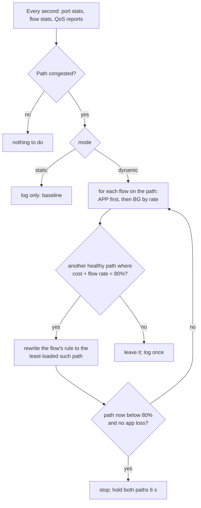
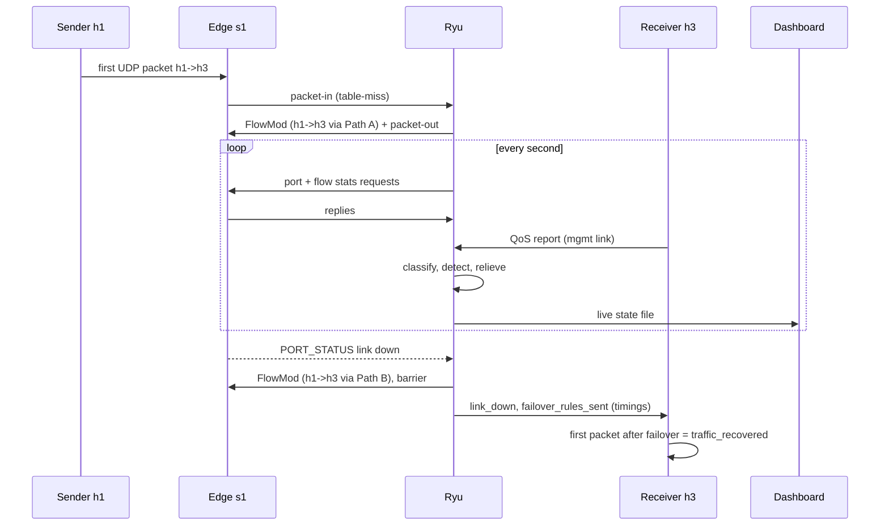

# Architecture – Project 27: Congestion Detection and Traffic Rerouting (UDP)

## 1. Problem

When a network has several paths between two points, traditional routing keeps
using one "best" path even after it becomes overloaded or fails. UDP
applications (video, voice, telemetry) suffer most: UDP has no retransmission
or congestion control, so an overloaded or broken path shows up directly as
packet loss, delay and jitter.

With SDN, a central controller sees the whole network, measures the load on
every path and can change forwarding rules at any time. This project uses that
to **detect congestion or a link failure on the path an application flow
uses, and move that flow to a healthier path within milliseconds to a couple
of seconds**, while leaving the traffic that causes the congestion where it is.

## 2. Objectives

1. UDP client/server with low-level sockets and an application header for
   measuring throughput, loss, delay and jitter, and for telling a finished
   flow from an interrupted one.
2. A Mininet topology with three independent paths.
3. A Ryu (OpenFlow 1.3) controller that learns flows, classifies them, monitors
   port and flow statistics and link status, and detects congestion.
4. Application QoS reports fed back to the controller, so application and
   network events both drive SDN decisions.
5. Dynamic reaction: load-aware rerouting on congestion, immediate failover on
   link failure, failback after repair.
6. A measured comparison against a static baseline, and a live dashboard.

## 3. Topology

```
                 +------ s2 ------+        Path A: s1 - s2 - s4  (default)
 h1 --+          |                |        Path B: s1 - s3 - s4
 h2 --+--- s1 ---+------ s3 ------+--- s4 --+-- h3  (UDP receiver)
 h4 --+          |                |         +-- h5  (background sink)
                 +------ s5 ------+        Path C: s1 - s5 - s4
                                           h3-eth1 ===== VM: Ryu + dashboard
                                           (management link, 192.168.100.0/24)
```

| Node | IP | Role |
|---|---|---|
| h1, h2 | 10.0.0.1, 10.0.0.2 | UDP senders (application flows) |
| h3 | 10.0.0.3 (+ 192.168.100.3 mgmt) | UDP receiver; sends QoS reports; receives SDN events |
| h4 | 10.0.0.4 | Background flood generator |
| h5 | 10.0.0.5 | Background sink |
| s1–s5 | dpid 1–5 | Open vSwitch, OpenFlow 1.3 (s1, s4 = edges; s2, s3, s5 = one per path) |
| Ryu | 127.0.0.1:6653 OpenFlow · UDP 9000 QoS + commands | SDN controller |
| Dashboard | http://localhost:8000 | live web view |

Every path link: **10 Mbps, 2 ms** (Mininet `TCLink`).

| Switch | Port 1 | Port 2 | Port 3 | Port 4 | Port 5 | Port 6 |
|---|---|---|---|---|---|---|
| s1 | h1 | h2 | h4 | s2 (A) | s3 (B) | s5 (C) |
| s2, s3, s5 | s1 | s4 | | | | |
| s4 | h3 | s2 (A) | s3 (B) | h5 | s5 (C) | |

## 4. Components

| Component | File | Responsibility |
|---|---|---|
| UDP sender | `udp_sender.py` | Datagrams at a set rate, 18-byte header, end-of-stream marker |
| UDP receiver | `udp_receiver.py` | Many senders on one socket; per-second stats; stall detection; QoS reports; SDN event channel; recovery timestamps; CSV |
| Topology | `topology.py` | Three paths, link limits, static ARP, management link |
| Controller | `controller.py` | Flow learning and classification, placement, monitoring, congestion relief, failover, failback, timing, live state, runtime commands |
| Dashboard | `dashboard.py` | Live charts, path cards, flow placement, events, recovery times, mode switch |
| Experiments | `run_experiments.py` | Every scenario in static and dynamic mode |
| Analysis | `analyze.py` | `RESULTS.md`, `summary.csv`, plots |

### 4.1 Packet format

```
 0              4         6               10                 18
 +--------------+---------+----------------+-----------------+---------+
 | magic (4B)   | id (2B) | sequence (4B)  | send time (8B)  | padding |
 +--------------+---------+----------------+-----------------+---------+
```
`struct` format `!4sHId`. Magic `JKFT` = data, `JKFE` = end of stream (sent 3
times when a sender finishes); anything else is dropped as malformed. Flow =
source IP + id. Sequence gaps = loss; send time = one-way delay and jitter (all
Mininet hosts share the VM's clock).

### 4.2 What the receiver reports each second

| Situation | Reported as |
|---|---|
| Packets arrived | throughput, loss (sequence gaps this second), mean delay, jitter |
| No packets, no end marker | **STALLED**: 100% loss (a dead path looks like this) |
| No packets after the end marker | finished; no longer reported |
| Packets resume after a stall | loss counted from the first new packet (no double counting) |

QoS report (UDP JSON to 192.168.100.1:9000 over the management link):
```json
{"type": "qos", "flow": "10.0.0.1#1", "thr_mbps": 1.98, "loss_pct": 0.0,
 "delay_ms": 5.1, "jitter_ms": 0.2, "stalled": false, "ts": 1761300000.0}
```

### 4.3 Controller → receiver events (UDP 5002 on h3)

`link_down`, `failover_rules_sent` (with `failover_rule_ms` = detection → rules
sent and `failover_install_ms` = detection → OpenFlow barrier reply), `link_up`,
`failback`. The receiver then timestamps the first packet of the affected flow
(`traffic_recovered`, `recovery_time_ms`). All of it goes into the same CSV.

### 4.4 Commands (UDP JSON to port 9000)

`{"type":"cmd","cmd":"mode","mode":"static"|"dynamic"}` puts every flow back on
Path A and switches mode, so each experiment starts from the same state.
`{"type":"cmd","cmd":"mark","text":"..."}` labels the event log, and
`{"type":"cmd","cmd":"reset"}` clears it. The dashboard and
`run_experiments.py` use these.

## 5. Flow rules

| Switch | Rule | Priority | Action |
|---|---|---|---|
| s1, s4 | `ipv4_dst` = a local host | 10 | its host port |
| s1, s4 | any other IPv4 (table-miss) | 1 | to the controller |
| s1, s4 | `ipv4_src, ipv4_dst` of a learned flow | 20 | the flow's path port; idle timeout 30 s, removal reported |
| s2, s3, s5 | `ipv4_dst` = left / right host | 10 | port 1 / port 2 |

The first packet of a new (src, dst) pair crossing the core reaches the
controller (packet-in). The controller creates a **Flow**, picks its path,
installs the priority-20 rule on the source edge switch and sends the packet on
(packet-out), so nothing is lost. Rerouting a flow = rewriting its one rule.

## 6. Decisions

**Classification.** A flow is **APP** if its destination sends QoS reports
(learned from the reports, or listed in `P27_APP_HOSTS`, default 10.0.0.3);
otherwise **BG**. This is re-checked continuously.

**Measurement (every second).** Port statistics on both edges give each path's
load per direction; utilization = the busier direction ÷ 10 Mbps. Flow
statistics give every flow's own rate. QoS reports give the application's loss.

**Congestion.** A path is congested when utilization ≥ 80% or application loss
on flows crossing it ≥ 5%.



* Path **cost** = measured utilization + 1 Mbps reserved for every flow placed
  there but not yet measured, so several flows moved at once spread out instead
  of all landing on the same empty path.
* A flow moves only if its measured rate fits on the target without pushing it
  over 80%. A 9 Mbps flood never fits, so it is **never chased** from path to
  path. The application flows leave it behind.
* After any move both paths are held for 6 s and stale QoS reports are
  discarded, so old measurements cannot trigger a second move (no ping-pong).
* After congestion, flows stay on their new path. All paths are equal, so
  there is no reason to move them back.

**Link failure.** An OpenFlow `PORT_STATUS` (link down) on any port of a path
marks it down at once. In dynamic mode every flow on it is moved immediately
(APP first) to the cheapest healthy path. The controller times detection →
rules sent, then sends an OpenFlow **barrier** and times detection → barrier
reply (= rules confirmed installed), and tells the receiver. In static mode,
flows stay on the dead path.

**Failback.** When a failed path comes back and stays up for 5 s, flows that
the failure displaced move back if they fit (same capacity check). The
controller gives up after 60 s.

**Incidents and recovery time.** An incident starts at the first detection
(congestion or link down) on a path carrying APP flows. It ends when every APP
flow is healthy (loss < 1%, delay < 20 ms, not stalled) for 2 seconds in a row.
The controller logs that time and shows it on the dashboard. `analyze.py`
measures the same thing from the receiver CSV, starting at the moment the
experiment triggered the problem.

## 7. Communication flow



## 8. Expected behaviour

| Scenario | Static (baseline) | Dynamic |
|---|---|---|
| h1 + h2, 2 Mbps each | Path A ~42%, 0% loss, ~5 ms | same |
| h4 floods 9 Mbps on A for 20 s | delay ~845 ms, ~20% loss for 20 s | APP flows moved to B/C within ~1–2 s; flood stays on A |
| Link s1–s2 down | APP flows stalled (100% loss) until repair | failover rules installed in ~15 ms; traffic back in tens of ms |
| Then s1–s3 down too | still stalled | flows move on to Path C |
| Link repaired | traffic resumes | failback to A after 5 s |

A run on the team's VM (`results/early_run/d2_results.csv`) measured a
failover with rules sent after 10.8 ms, installation confirmed after 15.1 ms,
and the first packet received 21.8 ms after the link went down.

## 9. Design decisions

* **Reactive per-flow rules**: any host pair works without configuration, and
  each flow can be placed and moved on its own.
* **APP/BG classes from the QoS reports**: the controller protects the flows
  whose receivers report quality, and doesn't move the flood along with them.
* **Capacity check before every move, plus hold-down**: no chasing, no ping-pong.
* **Barrier-confirmed timing**: failover time is measured, not guessed.
* **Static ARP**: the topology has loops, so ARP broadcasts would circulate forever.
* **Fixed port map**: no topology discovery needed. At larger scale, LLDP
  discovery (`--observe-links`) and per-link statistics would replace it.
* **UDP**: TCP would retransmit and slow down, hiding the congestion.
* **End-of-stream marker**: silence means a failure, not a finished sender.
* **Dashboard reads a state file**: the controller never waits on the web page,
  and the page works offline.
