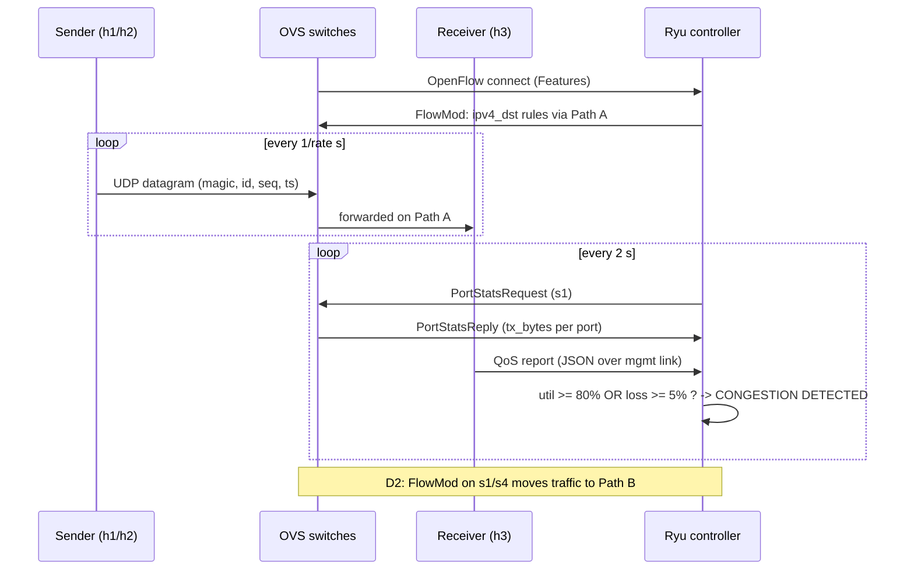

# Architecture – Project 27: Congestion Detection and Traffic Rerouting (UDP)

## 1. Problem

When a network has more than one path between two points, traditional routing
usually keeps sending traffic over one "best" path even after that path becomes
overloaded. UDP applications (video, voice, telemetry) suffer most, because UDP
has no retransmission or congestion control: an overloaded path shows up
directly as packet loss, delay and jitter.

Software-Defined Networking (SDN) separates the control logic from the
switches. A central controller can see the whole network, measure load on each
path, and change forwarding rules at any time. This project uses that to
**detect congestion on the active path and move UDP traffic onto a less-loaded
path**.

## 2. Objectives

1. Generate UDP traffic between several hosts using low-level sockets, with an
   application header that lets the receiver measure throughput, loss, delay
   and jitter.
2. Build a Mininet topology with two independent paths between the senders and
   the receiver.
3. Write an SDN controller (Ryu, OpenFlow 1.3) that installs forwarding rules,
   monitors port statistics, and detects congestion using thresholds.
4. Feed application-level QoS measurements from the receiver back to the
   controller, so both network and application events drive SDN decisions.
5. (D2) Reroute traffic to the alternate path when congestion is detected and
   compare recovery time and throughput against a static (no-reroute) baseline.

## 3. Topology

```
              +------ s2 ------+          Path A: s1 - s2 - s4  (default)
              |                |          Path B: s1 - s3 - s4  (alternate)
 h1 --+       |                |       +-- h3  (UDP receiver)
 h2 --+-- s1 -+                +- s4 --+
 h4 --+       |                |       +-- h5  (background sink)
              +------ s3 ------+
                                         h3-eth1 ===== VM / Ryu
                                         (management link, 192.168.100.0/24)
```

| Node | IP | Role |
|---|---|---|
| h1, h2 | 10.0.0.1, 10.0.0.2 | UDP senders (application flows) |
| h3 | 10.0.0.3 (+ 192.168.100.3 mgmt) | UDP receiver; sends QoS reports |
| h4 | 10.0.0.4 | Background traffic generator (creates congestion) |
| h5 | 10.0.0.5 | Background traffic sink |
| s1–s4 | dpid 1–4 | Open vSwitch, OpenFlow 1.3 |
| Ryu | 127.0.0.1:6653 (OpenFlow), 192.168.100.1:9000 (QoS) | SDN controller |

Links on both paths are limited to **10 Mbps with 2 ms delay** (Mininet
`TCLink`). That makes congestion easy to create and measure.

Fixed switch ports, which the controller relies on:

| Switch | Port 1 | Port 2 | Port 3 | Port 4 | Port 5 |
|---|---|---|---|---|---|
| s1 | h1 | h2 | h4 | s2 (Path A) | s3 (Path B) |
| s2 | s1 | s4 | | | |
| s3 | s1 | s4 | | | |
| s4 | h3 | s2 (Path A) | s3 (Path B) | h5 | |

## 4. Components

| Component | File | Responsibility |
|---|---|---|
| UDP sender | `udp_sender.py` | Sends fixed-size datagrams at a set rate; each starts with an 18-byte header |
| UDP receiver | `udp_receiver.py` | Receives from many senders on one socket; per-flow stats; CSV log; QoS reports to the controller |
| Topology | `topology.py` | Builds the two-path network, link limits, static ARP, management link |
| Controller | `controller.py` | Proactive flow rules, port-stats monitoring, QoS listener, combined congestion decision |

### 4.1 Application packet format (UDP payload)

```
 0                   4         6                   10                  18
 +-------------------+---------+-------------------+-------------------+----------+
 | magic "JKFT" (4B) | id (2B) |   sequence (4B)   |  send time (8B)   | padding  |
 +-------------------+---------+-------------------+-------------------+----------+
```
Packed with `struct` in network byte order (`!4sHId`).

* **magic** rejects stray or malformed packets.
* **id + source IP** identify a flow, so one socket can serve many senders.
* **sequence** gives loss (gaps) and reordering.
* **send time** gives one-way delay and jitter. All Mininet hosts share the VM's clock.

### 4.2 QoS report format (receiver → controller)

One UDP datagram per flow, every report interval (default 2 s), UTF-8 JSON:

```json
{"type": "qos", "flow": "10.0.0.1#1", "thr_mbps": 1.98,
 "loss_pct": 0.0, "delay_ms": 8.4, "jitter_ms": 0.2, "ts": 1761300000.0}
```

`loss_pct` and `delay_ms` cover only the time **since the previous report**, so they react quickly.

The report travels over a separate **management link** (h3-eth1 ↔ VM). It
does not cross the OpenFlow switches, which matches how real SDN networks
keep control traffic out-of-band. It also means congestion on the data path
cannot block the reports.

## 5. Communication flow



## 6. Congestion detection logic

Every 2 seconds the controller:

1. Computes the load on each path from the change in `tx_bytes` on s1 port 4
   (Path A) and port 5 (Path B): `Mbps = Δbytes × 8 / 2 s / 10⁶`.
2. Utilization = load / 10 Mbps.
3. Looks at the most recent QoS reports (no older than 6 s) and takes the worst loss.
4. Marks the active path **congested** if:
   * utilization ≥ **80%** (network view), **or**
   * application loss ≥ **5%** (application view).
5. Logs `CONGESTION DETECTED` when the state changes to congested, and
   `Congestion cleared` when it changes back.

In D2, step 5 also calls `set_path()`, which rewrites the rules on s1 and s4
so traffic uses the other path. s2 and s3 already carry rules for both
directions, so only the edge switches change.

## 7. Expected network behaviour

| Scenario | Path A load | Receiver (h3) | Controller |
|---|---|---|---|
| h1 + h2 at 2 Mbps each | ~4 Mbps (40%) | ~2 Mbps per flow, ~0% loss, ~4–6 ms one-way delay | `ok` |
| + h4 → h5 flood at 9 Mbps | ~10 Mbps (~100%) | loss rises, delay rises sharply (queueing) | `HIGH`, `CONGESTION DETECTED` |
| Flood stops | back to ~4 Mbps | loss returns to 0 | `Congestion cleared` |
| (D2) reroute enabled | app flows on Path B | loss drops again after a short recovery time | `Rerouting: Path A -> Path B` |

## 8. Design decisions

* **Proactive rules matched on destination IP.** Rules are installed as soon as a
  switch connects, so there are no packet-in delays. Changing a path means
  rewriting a few rules on two switches.
* **Static ARP.** The topology has a loop (s1–s2–s4–s3–s1). ARP broadcasts would
  circulate forever, so Mininet pre-fills every host's ARP table instead.
* **Fixed port numbers.** The controller maps ports to paths without needing
  topology discovery.
* **UDP, not TCP.** TCP would retransmit lost packets and slow down under
  congestion, hiding the problem the project needs to detect.
* **Two views of congestion.** Port stats see link load. QoS reports see what
  the application actually experiences. Using both covers cases where one
  alone would miss the problem.
